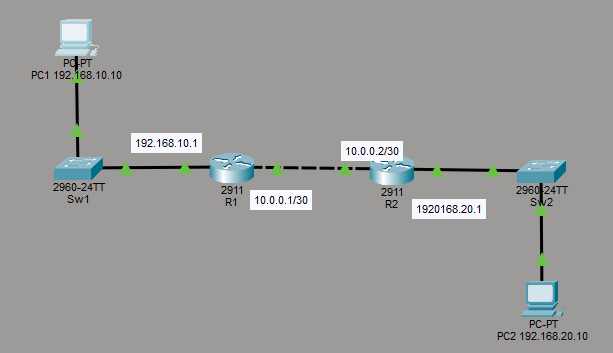
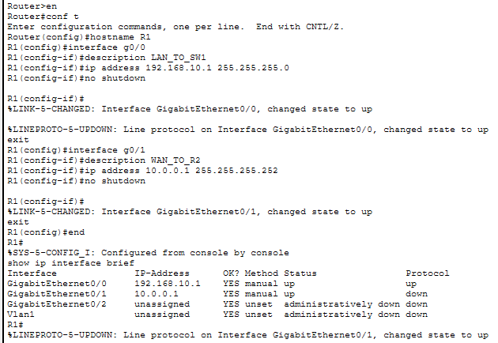
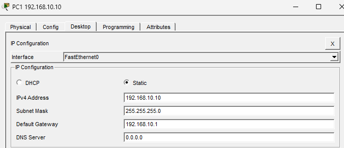
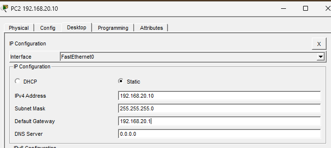
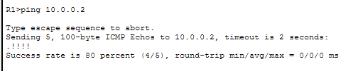
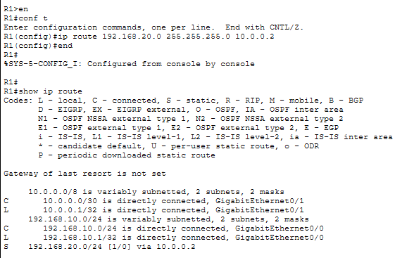
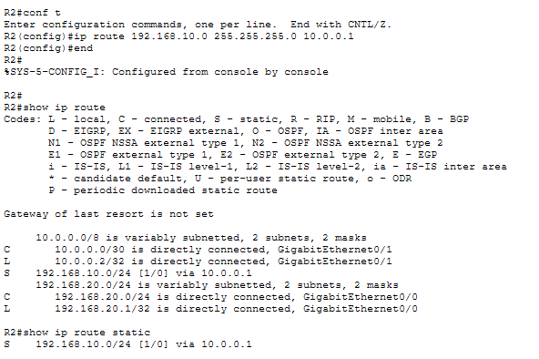
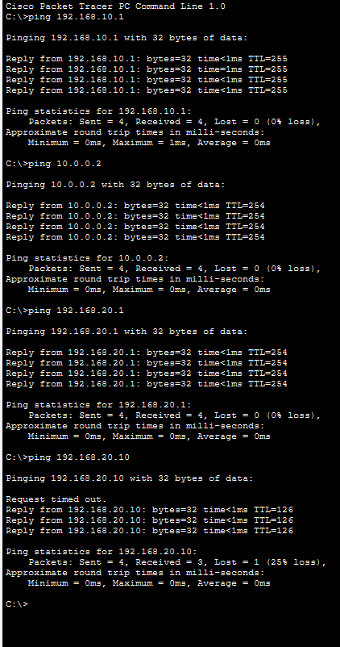
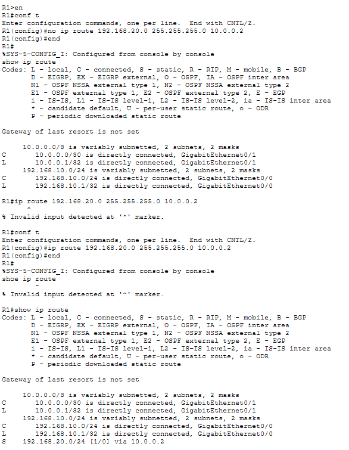

# Lab 05 — Static Routing Between Multiple Networks

## 1. Overview

This lab demonstrates the configuration, verification, and troubleshooting of static routing between two different LAN networks using Cisco Packet Tracer.

Two Cisco 2911 routers are connected through a point-to-point WAN network. Each router connects to a separate LAN containing a PC.

Static routes are configured on both routers to enable end-to-end communication between the remote networks.

A simulated routing failure is also introduced to practice NOC troubleshooting procedures.

## 2. Objectives

- Configure router interfaces with IPv4 addresses.
- Connect two routers through a WAN link.
- Configure PC default gateways.
- Understand directly connected and remote networks.
- Configure static routes using next-hop addresses.
- Verify routing tables.
- Test end-to-end connectivity.
- Diagnose missing static routes.
- Document network incidents and corrective actions.

## 3. Tools and Technologies

- Cisco Packet Tracer
- Cisco 2911 Routers
- Cisco Catalyst 2960 Switches
- PC-PT
- Cisco IOS CLI
- IPv4 Addressing and Subnetting
- Static Routing
- ICMP
- ARP
- Network Troubleshooting

## 4. Network Topology



### Network Diagram

```text
PC1                 PC2
 |                   |
SW1                 SW2
 |                   |
R1 ---------------- R2
     10.0.0.0/30
```

### Device Connections

| Device | Interface | Connected Device | Interface |
|---|---|---|---|
| PC1 | Fa0 | SW1 | Fa0/1 |
| SW1 | Gi0/1 | R1 | G0/0 |
| R1 | G0/1 | R2 | G0/1 |
| R2 | G0/0 | SW2 | Gi0/1 |
| SW2 | Fa0/1 | PC2 | Fa0 |

## 5. IP Addressing Plan

| Device | Interface | IP Address | Subnet Mask |
|---|---|---|---|
| PC1 | FastEthernet0 | 192.168.10.10 | 255.255.255.0 |
| R1 | G0/0 | 192.168.10.1 | 255.255.255.0 |
| R1 | G0/1 | 10.0.0.1 | 255.255.255.252 |
| R2 | G0/1 | 10.0.0.2 | 255.255.255.252 |
| R2 | G0/0 | 192.168.20.1 | 255.255.255.0 |
| PC2 | FastEthernet0 | 192.168.20.10 | 255.255.255.0 |

### Default Gateway Configuration

| PC | Default Gateway |
|---|---|
| PC1 | 192.168.10.1 |
| PC2 | 192.168.20.1 |

### Network Information

| Network | Purpose |
|---|---|
| 192.168.10.0/24 | LAN 1 |
| 10.0.0.0/30 | Router-to-router WAN |
| 192.168.20.0/24 | LAN 2 |

## 6. R1 Configuration

### Configure LAN Interface

```cisco
enable
configure terminal

hostname R1

interface gigabitEthernet 0/0
 description LAN_TO_SW1
 ip address 192.168.10.1 255.255.255.0
 no shutdown
exit
```

### Configure WAN Interface

```cisco
interface gigabitEthernet 0/1
 description WAN_TO_R2
 ip address 10.0.0.1 255.255.255.252
 no shutdown
exit

end
```

### Verify R1 Interfaces

```cisco
show ip interface brief
```



## 7. R2 Configuration

### Configure LAN Interface

```cisco
enable
configure terminal

hostname R2

interface gigabitEthernet 0/0
 description LAN_TO_SW2
 ip address 192.168.20.1 255.255.255.0
 no shutdown
exit
```

### Configure WAN Interface

```cisco
interface gigabitEthernet 0/1
 description WAN_TO_R1
 ip address 10.0.0.2 255.255.255.252
 no shutdown
exit

end
```

### Verify R2 Interfaces

```cisco
show ip interface brief
```

## 8. PC Configuration

### PC1

```text
IP Address:      192.168.10.10
Subnet Mask:     255.255.255.0
Default Gateway: 192.168.10.1
```

### PC2

```text
IP Address:      192.168.20.10
Subnet Mask:     255.255.255.0
Default Gateway: 192.168.20.1
```




## 9. WAN Connectivity Verification

Before configuring static routes, verify that both routers can communicate over the directly connected WAN network.

On R1:

```cisco
ping 10.0.0.2
```

On R2:

```cisco
ping 10.0.0.1
```

Expected result: Successful communication between the router WAN interfaces.



## 10. Static Route Configuration

### Configure Static Route on R1

R1 requires a route to the remote LAN `192.168.20.0/24`.

```cisco
enable
configure terminal

ip route 192.168.20.0 255.255.255.0 10.0.0.2

end
```

### Configure Static Route on R2

R2 requires a return route to `192.168.10.0/24`.

```cisco
enable
configure terminal

ip route 192.168.10.0 255.255.255.0 10.0.0.1

end
```

### Static Route Explanation

```text
ip route [destination-network] [subnet-mask] [next-hop-address]
```

| Parameter | Purpose |
|---|---|
| Destination network | Remote network to reach |
| Subnet mask | Identifies the destination network size |
| Next-hop address | IP address of the next router |

## 11. Routing Table Verification

### R1 Routing Table

```cisco
show ip route
show ip route static
```

Expected static route:

```text
S 192.168.20.0/24 [1/0] via 10.0.0.2
```



### R2 Routing Table

```cisco
show ip route
show ip route static
```

Expected static route:

```text
S 192.168.10.0/24 [1/0] via 10.0.0.1
```



## 12. End-to-End Connectivity Testing

From PC1:

```text
ping 192.168.10.1
ping 10.0.0.2
ping 192.168.20.1
ping 192.168.20.10
```

From PC2:

```text
ping 192.168.20.1
ping 10.0.0.1
ping 192.168.10.1
ping 192.168.10.10
```

### Connectivity Test Results

| Source | Destination | Expected Result | Actual Result |
|---|---|---|---|
| PC1 | R1 LAN Gateway | Success |  Success|
| R1 | R2 WAN Interface | Success | Success |
| PC1 | R2 LAN Gateway | Success | Success |
| PC1 | PC2 | Success | Success |
| PC2 | PC1 | Success | Success |



## 13. Understanding Static Routing

Static routing is a routing method in which network administrators manually configure routes to remote networks.

In this lab:

- R1 knows the local LAN `192.168.10.0/24`.
- R1 knows the WAN network `10.0.0.0/30`.
- R1 uses a static route to reach `192.168.20.0/24` through `10.0.0.2`.
- R2 uses a static route to reach `192.168.10.0/24` through `10.0.0.1`.

The return route is necessary for successful two-way communication.

### Packet Flow

1. PC1 identifies PC2 as a remote destination.
2. PC1 sends the packet to its default gateway, R1.
3. R1 checks its routing table.
4. R1 matches the static route to `192.168.20.0/24`.
5. R1 forwards the packet to R2 at `10.0.0.2`.
6. R2 forwards the packet to PC2.
7. PC2 replies through its default gateway.
8. R2 uses its static route to return traffic through R1.

The IP addresses remain unchanged during normal routing, while the Layer 2 headers are rebuilt at each router hop.

## 14. Troubleshooting Scenario — Missing Static Route

### Incident Description

PC1 can reach its local gateway and the remote router's WAN interface, but cannot communicate with PC2.

### Fault Introduced

The static route on R1 is deliberately removed.

```cisco
configure terminal

no ip route 192.168.20.0 255.255.255.0 10.0.0.2

end
```

### Symptoms

- PC1 can ping its local gateway.
- R1 can reach R2 through the WAN link.
- PC1 cannot reach PC2's LAN.
- R1 has no route to `192.168.20.0/24`.

### Diagnostic Commands

```cisco
show ip route
show ip route static
show running-config
```

### Root Cause

The static route to the remote LAN `192.168.20.0/24` was missing from R1.

### Corrective Action

```cisco
configure terminal

ip route 192.168.20.0 255.255.255.0 10.0.0.2

end
```

### Post-Recovery Verification

```cisco
show ip route
```

From PC1:

```text
ping 192.168.20.10
```

Expected result: Successful communication after restoring the route.



## 15. NOC Incident Report

| Field | Details |
|---|---|
| Incident ID | LAB05-ROUTING-001 |
| Incident | Remote LAN connectivity failure |
| Affected Network | 192.168.20.0/24 |
| Root Cause | Missing static route on R1 |
| Diagnostic Commands | show ip route, show running-config |
| Corrective Action | Restored static route |
| Verification | ping 192.168.20.10 |
| Incident Status |resolved |

## 16. Key Learning Outcomes

- Configured two Cisco routers.
- Assigned IPv4 addresses to router interfaces.
- Connected separate LAN networks through a WAN link.
- Configured PC default gateways.
- Understood directly connected and remote networks.
- Implemented static routes using next-hop addresses.
- Verified static routing tables.
- Tested end-to-end connectivity.
- Diagnosed and corrected missing route problems.
- Practiced NOC-style incident documentation.

## 17. Lab Files

### Packet Tracer Project

[Download Lab 05 — Static Routing](Lab-05-Static-Routing.pkt)

### Screenshots

- [Network Topology](screenshots/topology.png)
- [PC IP Configuration](screenshots/ip-configuration.png)
- [Router Interface Verification](screenshots/router-interfaces.png)
- [WAN Connectivity](screenshots/wan-connectivity.png)
- [R1 Routing Table](screenshots/r1-routing-table.png)
- [R2 Routing Table](screenshots/r2-routing-table.png)
- [End-to-End Ping](screenshots/end-to-end-ping.png)
- [Troubleshooting Evidence](screenshots/troubleshooting.png)

## 18. How to Run the Lab

1. Install Cisco Packet Tracer.
2. Download `Lab-05-Static-Routing.pkt`.
3. Open the project in Packet Tracer.
4. Verify router interface configurations.
5. Check PC IP addresses and default gateways.
6. Verify WAN connectivity.
7. Inspect static routes on both routers.
8. Test communication between PC1 and PC2.
9. Reproduce and correct the missing-route incident.
10. Save the corrected configurations.

## 19. Project Status

| Component | Status |
|---|---|
| Network Topology | completed |
| Router Interface Configuration | Verified|
| WAN Connectivity | Verified |
| Static Route Configuration | Verified |
| Routing Table Verification | Verified |
| End-to-End Connectivity | Verified |
| Troubleshooting Exercise | Verified |
| GitHub Documentation | Completed |


---

## Network Troubleshooting Labs

**Lab:** 05 — Static Routing Between Multiple Networks

**Platform:** Cisco Packet Tracer

**Focus:** IPv4 Routing, Static Routes, WAN Connectivity, Verification and NOC Troubleshooting.

