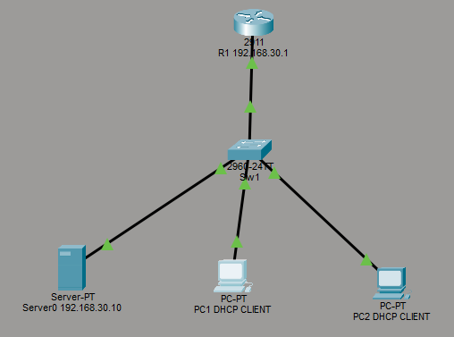
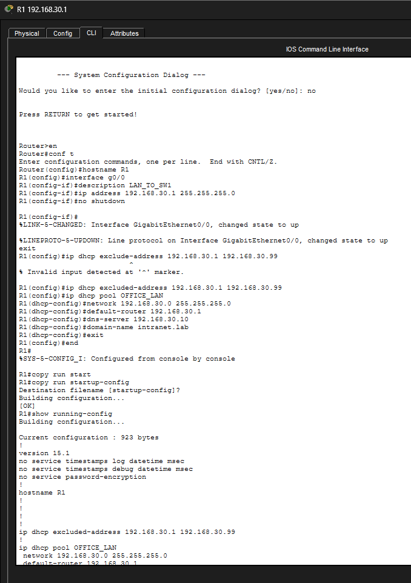
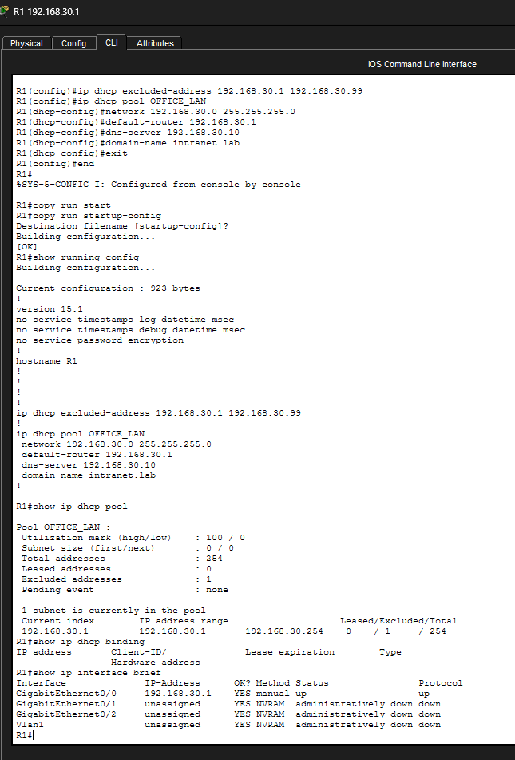
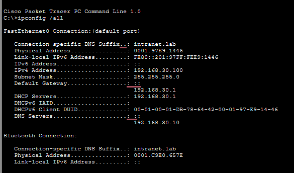
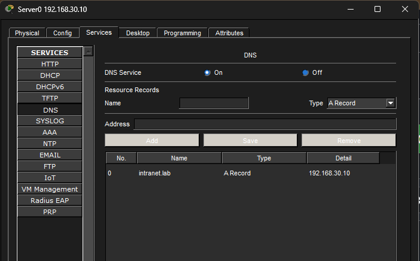
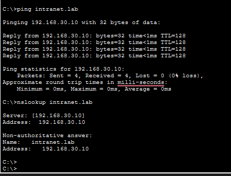
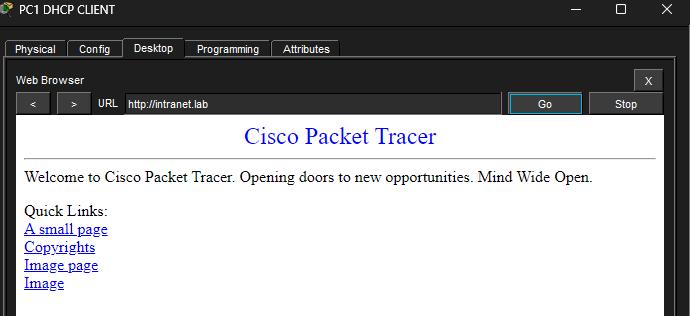
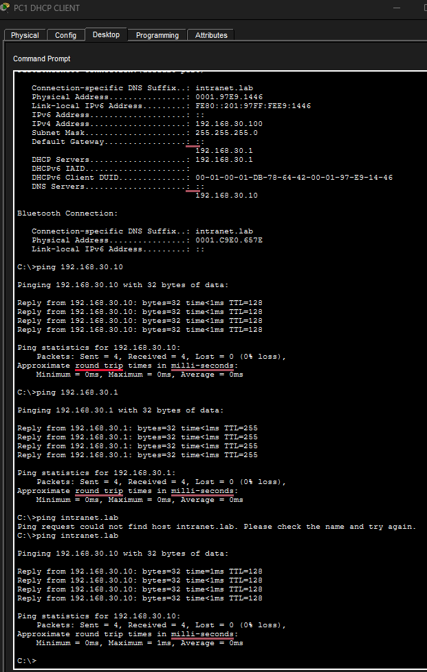

# Lab 04 — DHCP & DNS Services Configuration and Troubleshooting

## 1. Overview

This lab demonstrates the configuration, verification, and troubleshooting of **DHCP (Dynamic Host Configuration Protocol)** and **DNS (Domain Name System)** in a Cisco Packet Tracer network.

A Cisco 2911 router is configured as the DHCP server to automatically assign IPv4 settings to client PCs.

A separate server provides DNS and HTTP services, allowing clients to access an internal website using the domain name `intranet.lab`.

The lab also simulates a DNS service outage and demonstrates how to diagnose and resolve it using a structured NOC troubleshooting approach.

## 2. Lab Objectives

- Configure a Cisco router as a DHCP server.
- Create a DHCP pool and exclude reserved IP addresses.
- Configure PCs to obtain IPv4 addresses automatically.
- Verify DHCP leases and address allocation.
- Configure a DNS server with an A record.
- Enable an HTTP web service.
- Verify DNS resolution and website accessibility.
- Troubleshoot DNS service failures.
- Document network troubleshooting results.

## 3. Tools and Technologies

- Cisco Packet Tracer
- Cisco 2911 Router
- Cisco Catalyst 2960 Switch
- Server-PT
- PC-PT
- Cisco IOS CLI
- IPv4 Addressing
- DHCP — UDP Ports 67/68
- DNS — UDP/TCP Port 53
- HTTP — TCP Port 80
- ICMP and ARP

## 4. Network Topology



### Network Diagram

                   R1 (Cisco 2911)
                  DHCP Server
                  192.168.30.1
                        |
                        |
                  SW1 (Cisco 2960)
                        |
             +----------+----------+
             |          |          |
          Server0      PC1        PC2
         DNS + HTTP    DHCP       DHCP
       192.168.30.10   Client     Client

### Device Connections

| Device | Interface | Connected Device | Interface |
|---|---|---|---|
| R1 | Gi0/0 | SW1 | Gi0/1 |
| Server0 | Fa0 | SW1 | Fa0/1 |
| PC1 | Fa0 | SW1 | Fa0/2 |
| PC2 | Fa0 | SW1 | Fa0/3 |

## 5. IP Addressing Scheme

| Device | IP Address | Subnet Mask | Default Gateway | DNS Server |
|---|---|---|---|---|
| R1 | 192.168.30.1 | 255.255.255.0 | N/A | N/A |
| Server0 | 192.168.30.10 | 255.255.255.0 | 192.168.30.1 | 192.168.30.10 |
| PC1 | DHCP | DHCP | DHCP | DHCP |
| PC2 | DHCP | DHCP | DHCP | DHCP |

### DHCP Pool Details

| Parameter | Configuration |
|---|---|
| Pool Name | OFFICE_LAN |
| Network | 192.168.30.0/24 |
| Excluded Range | 192.168.30.1–192.168.30.99 |
| Assignable Range | 192.168.30.100–192.168.30.254 |
| Default Gateway | 192.168.30.1 |
| DNS Server | 192.168.30.10 |
| Domain Name | intranet.lab |

## 6. Router Configuration

### Step 1 — Configure Router Interface

```cisco
enable
configure terminal

hostname R1

interface gigabitEthernet 0/0
 description LAN_TO_SW1
 ip address 192.168.30.1 255.255.255.0
 no shutdown
exit
```


### Step 2 — Exclude Reserved IP Addresses

```cisco
ip dhcp excluded-address 192.168.30.1 192.168.30.99
```

The excluded range prevents DHCP from assigning addresses reserved for infrastructure devices.

### Step 3 — Create DHCP Pool

```cisco
ip dhcp pool OFFICE_LAN
 network 192.168.30.0 255.255.255.0
 default-router 192.168.30.1
 dns-server 192.168.30.10
 domain-name intranet.lab
exit

end
copy running-config startup-config
```

### Step 4 — Verify DHCP Configuration

```cisco
show running-config
show ip dhcp pool
show ip dhcp binding
show ip interface brief
```





## 7. DHCP Client Configuration

On PC1 and PC2:

1. Open the PC in Cisco Packet Tracer.
2. Navigate to **Desktop → IP Configuration**.
3. Select **DHCP**.
4. Allow the client to obtain its network configuration.

### Verification Command

```text
ipconfig /all
```

### Expected Configuration

- IPv4 address within `192.168.30.100–192.168.30.254`
- Subnet mask: `255.255.255.0`
- Default gateway: `192.168.30.1`
- DNS server: `192.168.30.10`

### Actual DHCP Allocation

| Device | Assigned IP Address | Status |
|---|---|---|
| PC1 | 192.168.30.100 | [Verified] |
| PC2 | 192.168.30.102 | [Verified] |



## 8. Understanding DHCP DORA

DHCP uses a four-step process to provide network configuration to clients.

### 1. DHCP Discover

The client broadcasts a DHCP Discover message to locate available DHCP servers.

### 2. DHCP Offer

The DHCP server responds with an available IP address and configuration options.

### 3. DHCP Request

The client requests the offered IP address.

### 4. DHCP Acknowledgment

The DHCP server acknowledges the request and confirms the lease.

### DHCP Message Sequence

```text
PC1                         R1 DHCP Server
 |                                 |
 |-------- DHCP DISCOVER -------->|
 |                                 |
 |<--------- DHCP OFFER ----------|
 |                                 |
 |-------- DHCP REQUEST --------->|
 |                                 |
 |<---------- DHCP ACK -----------|
 |                                 |
 |       IP Address Assigned       |
```

**Technical Note:** Initial DHCP messages normally use broadcast communication because a new client does not yet have a valid IPv4 address.

## 9. DNS Server Configuration

### Step 1 — Configure Server0 IP Address

Open:

**Server0 → Desktop → IP Configuration**

Configure:

```text
IP Address:       192.168.30.10
Subnet Mask:      255.255.255.0
Default Gateway:  192.168.30.1
DNS Server:       192.168.30.10
```

### Step 2 — Enable DNS Service

Navigate to:

**Server0 → Services → DNS**

Set DNS Service to **On**.

### Step 3 — Configure DNS A Record

| Field | Value |
|---|---|
| Name | intranet.lab |
| Type | A Record |
| Address | 192.168.30.10 |

Click **Add** to create the record.



## 10. DNS Resolution Verification

From PC1, open Command Prompt and run:

```text
ping intranet.lab
```

Expected hostname resolution:

```text
intranet.lab -> 192.168.30.10
```

If supported by the Packet Tracer version, also run:

```text
nslookup intranet.lab
```

### Explanation

When PC1 attempts to communicate with `intranet.lab`:

1. PC1 checks its local name-resolution information.
2. If necessary, it sends a DNS query to `192.168.30.10`.
3. The DNS server finds the matching A record.
4. The server returns `192.168.30.10`.
5. PC1 uses that IP address to communicate with the destination.



## 11. HTTP Web Server Configuration

Open:

**Server0 → Services → HTTP**

Enable HTTP.

The default webpage can be customized through `index.html`.

### Web Browser Verification

On PC1:

**Desktop → Web Browser**

Enter:

```text
http://intranet.lab
```

### Expected Result

The internal webpage should load successfully after DNS resolves the hostname.



## 12. Connectivity Testing

### Commands Used

```text
ipconfig /all

ping 192.168.30.1

ping 192.168.30.10

ping intranet.lab
```

### Connectivity Test Matrix

| Test | Expected Result | Actual Result |
|---|---|---|
| PC1 receives DHCP IP | Success |Success  |
| PC2 receives DHCP IP | Success | Success |
| PC1 to R1 ping | Success | Success |
| PC1 to Server0 ping | Success |Success |
| DNS hostname resolution | Success | Success |
| HTTP access using hostname | Success |Success |


## 13. Troubleshooting Scenario — DNS Service Failure

### Incident Description

Users report that they cannot access the internal website using `intranet.lab`.

However, the server remains reachable through its IP address.

### Simulated Failure

On Server0:

**Services → DNS → Off**

This disables DNS resolution while leaving other network services available.

### Symptoms

- Clients retain valid IPv4 addresses.
- IP connectivity to the server is functional.
- New DNS queries fail.
- Access using the domain name fails when it requires fresh DNS resolution.

### Troubleshooting Procedure

#### Step 1 — Verify Client IP Configuration

```text
ipconfig /all
```

Check the following:

- Valid client IPv4 address
- Correct subnet mask
- Correct default gateway
- Correct DNS server address

#### Step 2 — Check Gateway Connectivity

```text
ping 192.168.30.1
```

This verifies connectivity to the router.

#### Step 3 — Check DNS Server Reachability

```text
ping 192.168.30.10
```

A successful ping indicates that the server's IP interface is reachable.

It does not prove that DNS is operational.

#### Step 4 — Test Hostname Resolution

```text
ping intranet.lab
```

If DNS has been disabled, a fresh name-resolution request should fail.

Previously cached DNS results may temporarily affect this test.

#### Step 5 — Inspect DNS Service

Navigate to:

**Server0 → Services → DNS**

Check whether the DNS service is enabled.

### Root Cause

The DNS service was intentionally disabled on Server0.

As a result, the server could no longer answer new DNS queries.

### Corrective Action

Enable DNS:

**Server0 → Services → DNS → On**

Verify that the A record exists:

```text
intranet.lab -> 192.168.30.10
```

### Post-Recovery Verification

```text
ping intranet.lab
```

Open the browser:

```text
http://intranet.lab
```

### Actual Troubleshooting Result

[Enter the observed results after restoring DNS.]



## 14. NOC Incident Report

| Field | Incident Details |
|---|---|
| Incident ID | LAB04-DNS-001 |
| Issue | Internal hostname resolution failure |
| Affected Service | DNS |
| Impact | Clients cannot resolve intranet.lab |
| IP Connectivity | Functional |
| Root Cause | DNS service disabled |
| Diagnostic Commands | ipconfig, ping, nslookup if supported |
| Resolution | Re-enabled DNS service |
| Final Verification | ping intranet.lab |
| Incident Status | [Resolved |

## 15. DHCP vs DNS

| Feature | DHCP | DNS |
|---|---|---|
| Full Form | Dynamic Host Configuration Protocol | Domain Name System |
| Purpose | Automatic IP configuration | Hostname resolution |
| Typical Ports | UDP 67/68 | UDP/TCP 53 |
| Primary Function | Assigns network settings | Resolves domain names |
| Example | Assigns 192.168.30.100 | Resolves intranet.lab |
| Network Role | Address management | Name resolution |

## 16. Key Learning Outcomes

After completing the lab, the following skills should be demonstrated:

- Cisco IOS DHCP server configuration
- DHCP pool creation and exclusions
- Dynamic IPv4 address allocation
- DHCP lease verification
- Client default gateway and DNS configuration
- DNS A record creation
- DNS hostname resolution
- HTTP service verification
- Basic network service troubleshooting
- Structured NOC incident documentation

## 17. Lab Files

### Packet Tracer Project

[Download Lab 04 — DHCP & DNS Services](Lab-04-DHCP-DNS-Services.pkt)

### Verification Screenshots

- [Network Topology](Screenshots/topology.png)
- [DHCP Configuration](Screenshots/dhcp-configuration.png)
- [DHCP Bindings](Screenshots/dhcp-binding.png)
- [Client IP Configuration](Screenshots/client-ipconfig.png)
- [DNS Record](Screenshots/dns-record.png)
- [DNS Resolution](Screenshots/dns-resolution.png)
- [Web Browser Verification](Screenshots/web-browser.png)
- [DNS Troubleshooting](Screenshots/dns-troubleshooting.png)

## 18. How to Run This Lab

1. Install Cisco Packet Tracer.
2. Download `Lab-04-DHCP-DNS-Services.pkt`.
3. Open the project in Packet Tracer.
4. Verify the router's DHCP pool.
5. Check IP configuration on both client PCs.
6. Inspect DHCP bindings on R1.
7. Verify the DNS configuration on Server0.
8. Open `http://intranet.lab` from PC1.
9. Perform the DNS troubleshooting exercise.
10. Restore the working configuration.

## 19. Project Status

| Component | Status |
|---|---|
| Network Topology | Completed |
| DHCP Server Configuration | Verified |
| DHCP Client Configuration | Verified |
| DNS Server Configuration | Verified |
| HTTP Server Configuration | Verified |
| Connectivity Verification | Verified |
| Troubleshooting Exercise | Verified |
| GitHub Documentation | Completed |


---

## Network Troubleshooting Labs

This lab is part of a practical Cisco networking portfolio covering network configuration, routing, switching, IP services, security, and troubleshooting.

**Lab 04 of 08 — DHCP & DNS Services**

**Platform:** Cisco Packet Tracer

**Focus:** Network Services, Verification, Troubleshooting, and NOC Operations

